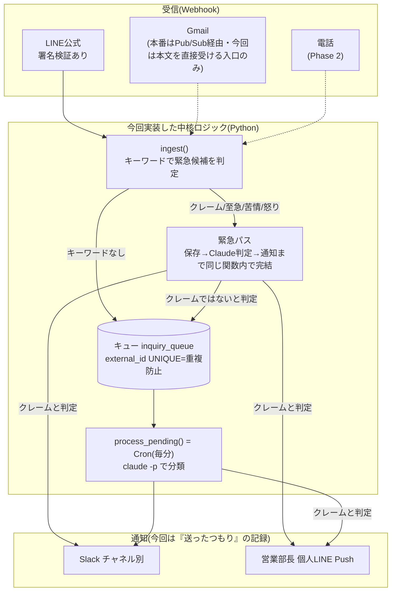

# 案件5: マルチチャネル通知 + AI自動分類(不動産管理会社)

メール・LINEでバラバラに届く問い合わせを1つの流れに集め、AIで「賃貸 / 売買 / 内見 / クレーム」に分類してSlackに振り分け、クレームだけは営業部長の個人LINEに5分以内で知らせる受付システム。

デモ画面(22件のテスト結果を再現): https://claude.ai/artifact/K64SRP7tmUqb8GhCsRn8qa

> **このリポジトリの状態(正直に)**: 受信 → 署名検証 → 重複防止 → 分類 → 振り分け → 緊急通知のロジックは、署名付きの模擬Webhookで動作確認済み。**本物のLINE・Slack・Gmailには接続していない**(送信は記録で代用)。詳しくは「設計と実際の実装が異なる点」を参照。

## 仕組み(アーキテクチャ)



流れ:
1. LINEのWebhookが届く → **署名検証**(通らなければ401で拒否)
2. 本文に「クレーム・至急・苦情・怒り」があれば**緊急パス**、なければ**通常パス**
3. 緊急パス: 同じ番号が処理済みなら何もしない(**冪等性**) → Claudeが最終判断 → クレームならSlack + 営業部長LINEに通知。クレームでなければ通常パスに戻す
4. 通常パス: キューに保存 → 毎分のCronで分類 → カテゴリ別のSlackチャネルへ

講座のコード例から変えた点: ①緊急パスでも重複チェックを先にする ②キーワードは入口、最終判断はClaude ③署名比較に`hmac.compare_digest` ④AI障害時は「要確認」付きで緊急通知 ⑤Cronの取り合い防止に「処理中」の札

## 動かし方(手元)

```bash
python3 run_tests.py   # 署名検証 / 22件の分類 / 重複防止 / 意地悪ケース(約3分。claude コマンドを使う)
python3 sla_test.py    # 緊急通知の速さを10件で測定
python3 monitor.py     # 件数と異常の確認(監視)
```

## 設計と実際の実装が異なる点

| 項目 | 設計・講座 | 今回の実装 |
|---|---|---|
| データベース | Supabase(PostgreSQL) | SQLite(作業環境から接続できないため代用。テーブルの形は同じ) |
| Slack・LINEへの送信 | 本物のAPI | `outbox`テーブルへの記録(呼び出し口の関数は本番と同じ形) |
| Gmail受信 | GmailのPub/Sub通知 → Gmail APIで本文取得 | 本文を直接受ける入口のみ(Pub/Sub未実装) |
| 分類のClaude呼び出し | Claude API | Headlessモード(`claude -p`)。作業環境にAPIキーが無かったため。本番でAPI直接に替える場合は`classifier.py`の関数の中身だけ差し替え |
| Webサーバー・Vercelデプロイ・Cron設定 | Next.js + Vercel Functions + Vercel Cron | 未実施(Pythonの関数として実装。呼び出しはテストから) |

## 納品物チェックリスト

| カテゴリ | 項目 | 結果 |
|---|---|---|
| 受信 | Gmail Webhook | **未実施**(本文を直接受ける入口のみ) |
| 受信 | LINE公式 Webhook | 署名検証+受信処理は実装・模擬Webhookでテスト済み。**本物のLINEからの送信は未実施** |
| 分類 | 4カテゴリ振り分け | 達成(22件中22件が期待どおり。Slackへの送信は記録で代用) |
| 緊急通知 | クレーム → LINE Push 5分以内(10件中9件以上) | 10件中9件がPush(約5秒、模擬送信)。**1件は分類がクレームにならずPushなし**(下の「既知の課題」参照) |
| キュー | 冪等性 | 達成(同じ通知を3回再送してもPush・Slack投稿とも増えない) |
| 運用 | 監視 | `monitor.py`(SQLite版)を実装。Supabase用のSQLは設計のみ |
| セキュリティ | 署名検証 | 達成(偽署名・本文の書き換え・署名なしは401で拒否、キューに入らない) |
| ドキュメント | 運用マニュアル | 作成済み(本書内) |

## 運用マニュアル(クライアント向け・紙1枚)

> 注: 本番環境が未構築のため、URLなどは仮の書き方。実装時に実際のものへ差し替える。

```
# マルチチャネル通知 運用マニュアル

## 普段の確認
- Slackの問い合わせチャネル(#賃貸の問い合わせ / #売買の問い合わせ / #内見希望 / #クレーム)を見るだけでOK
- 「#要確認」には、AIが判断できなかったもの・不動産と無関係なものが入ります。1日1回のぞいてください
- クレームは、営業部長の個人LINEにも届きます

## 障害だと感じたら
1. Vercelのダッシュボードで、Functionsのエラーログを確認
2. Supabaseで inquiry_queue テーブルの status='failed' を確認
3. 5分以上Slackに通知が来ない場合 → 開発担当へ連絡(連絡先: ______)

## APIキーの再発行が必要なとき
- 下の「APIキーのローテーション手順」を、開発担当に依頼してください
```

## APIキーのローテーション手順(開発者向け)

「キーが漏れたらどうすればいいですか?」にそのまま渡せる1ページ。**手順を実行する前に、各サービスの画面名・URLが変わっていないか確認すること。**

**共通の流れ**: ①新しいキーを発行 → ②Vercelの環境変数を新しいキーに更新 → ③再デプロイで反映 → ④テストメッセージで動作確認 → ⑤**古いキーを無効化(最後に)**。先に古いキーを消すと、その間は通知が止まる。

| サービス | 再発行する場所(目安) | 更新する環境変数 |
|---|---|---|
| LINE | LINE Developersコンソール → チャネル → Channel secret / Channel access token | `LINE_CHANNEL_SECRET`, `LINE_CHANNEL_ACCESS_TOKEN` |
| Slack | Slack API(アプリ設定) → OAuth & Permissions → Bot Token | `SLACK_BOT_TOKEN` |
| Gmail | Google Cloud Console → 認証情報(OAuth) | Gmail用の認証情報 |
| Anthropic | Anthropic Console → API Keys | `ANTHROPIC_API_KEY`(API直接呼び出しの場合) |

**動作確認チェック**:
- [ ] LINEから普通のメッセージを送り、Slackの該当チャネルに届く
- [ ] 「至急、クレームです」と送り、営業部長のLINEに届く
- [ ] 偽の署名でWebhookを叩くと401で弾かれる

**漏洩を防ぐ**:
- キーはコードに書かず、Vercelの環境変数だけに置く(GitHubに上げない)
- `.env`系のファイルは`.gitignore`に入れる

## 環境変数一覧(本番で必要なもの)

> 今回の手元実装では、秘密の値はテスト用のダミーをコード内に置いているだけ。本番では下の環境変数に置き換える。

| 名前 | 用途 |
|---|---|
| `LINE_CHANNEL_SECRET` | LINE Webhookの署名検証 |
| `LINE_CHANNEL_ACCESS_TOKEN` | LINEへのPush送信 |
| `LINE_MANAGER_USER_ID` | 営業部長のLINEユーザーID(Push先) |
| `SLACK_BOT_TOKEN` | Slackへの投稿 |
| `SLACK_CHANNEL_*` | カテゴリ別のSlackチャネルID |
| `ANTHROPIC_API_KEY` | 分類(API直接呼び出しの場合) |
| `SUPABASE_URL` / `SUPABASE_SECRET_KEY` | キュー用データベース |
| `CRON_SECRET` | Cron用URLを第三者に叩かれないための合言葉 |

## 監視(最小コスト)

本格的な監視ツールは月額予算に合わないので、SQL 1本で見る。`monitor.py`が同じ考え方(手元のSQLite版)。

```sql
-- 直近24時間の状態別件数(本番のSupabase用)
SELECT status, COUNT(*) FROM inquiry_queue
WHERE created_at > NOW() - INTERVAL '24 hours'
GROUP BY status;
```

`monitor.py`は、これに加えて次の2つを検知する。
- 失敗(failed)が5件以上 → Slackに警告
- 「処理中」のまま10分以上止まっているもの → Slackに警告(前回のCronが途中で止まったときの検知)

本番では、これを1時間ごとのCronで回すと、無料の障害検知になる。

## 既知の課題・制限

1. **「緊急=クレーム」の定義が狭い**: SLAの10件テストで「水漏れで下の階に迷惑をかけています。至急来てください。」が、苦情ではなく修理の依頼と判断され(賃貸に分類)、営業部長への緊急通知が出なかった。水漏れのような**設備トラブルを緊急扱いにするか**は、クライアントに確認が必要(ヒアリング質問9「緊急とみなすのはどんな問い合わせですか?」の答えしだい)。決めてあれば、緊急の種類を足して対応できる
2. **キーワードに当たらないクレームは通常パス**: 「誠意ある対応をしてください」のように、クレームでも「クレーム・至急・苦情・怒り」を含まない文章は通常パスに入り、次のCronでの分類を待つ。この場合の通知までの時間は、Cronの間隔(最大1分)+前に並んでいる件数しだいで、**実測していない**
3. **分類の速さ**: 1件あたり約5秒(Headless)。20件で約90秒かかり、1分ごとのCronの間隔を超える。「処理中」の札で取り合いは防いでいるが、件数が増えたら1回の処理件数を絞るか、並列化が必要
4. **「処理中」のまま残る問題**: 処理中に止まると、その問い合わせは「処理中」のまま残る。`monitor.py`が検知して警告するが、自動では戻さない
5. **月額コストは未検証**: 講座の目安(月額約1.5万円)は、実際に測っていない
6. **Gmailは未実装**: Pub/Sub経由の受信が必要

## Phase 2 提案: 電話自動応答 + テキスト化(講座の例を参考にした提案)

**現状の課題**: 月50件の電話のうち、営業時間外の取りこぼしが続く。電話の内容がSlackに乗らないため、対応履歴が断片的。

**提案**: Twilioで050番号を取得 → 着信を音声で受け、音声認識でテキスト化 → 既存のAI分類フローに合流。

**費用・期間(講座の例の数字)**: 初期12万円 / 月額+5,000円 / 3営業日。

あわせて、納品時に次の2つも提案できる:
- 「緊急」の定義の見直し(設備トラブルなども対象にするか)
- 本物のLINE・Slack・Gmailでの接続確認と、本番デプロイ(今回の未実施分)

## ファイル構成

- `security.py`: LINE署名の作成・検証
- `db.py`: キュー(SQLite)。`external_id`のUNIQUEで重複防止
- `classifier.py`: Claudeによる分類(Headlessモード)
- `notifiers.py`: Slack・LINE Pushの送信(記録で代用)
- `pipeline.py`: 受信(通常/緊急パス)とCron処理
- `monitor.py`: 監視(件数・失敗・停止の検知)
- `run_tests.py`: 統合テスト(署名検証・22件・重複防止・意地悪ケース)
- `sla_test.py`: 緊急通知の10件測定
- `case5-test-inquiries.csv`: テスト問い合わせ22件
- `test_results.json` / `sla_results.json`: テスト結果の記録
